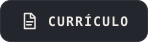

<picture></picture>
 

  
<picture></picture>

<b>Sobre mim</b>

 

Trabalho na interseção entre inteligência artificial, automação e desenvolvimento web. Entendo o processo, desenho a arquitetura, construo a interface, integro os sistemas e entrego funcionando em produção.

Acredito que interface boa é aquela que facilita: o usuário resolve o que veio resolver e vai embora. É esse padrão que aplico em UI/UX, e é o mesmo rigor que levo para o back-end.

## Experiência e formação

<picture></picture>

<b>Atividades em detalhe</b>

 

**Desenvolvedor web** · Autônomo · `2026 – atual` 
Sites, sistemas e automações para clientes, como o site da Santos Barber Studio e um sistema de controle de caixa com painel e relatórios.

**Jovem Aprendiz (CIEE)** · Colégio Santa Ângela · `mai/2025 – mar/2026` 
Manutenção e suporte em computadores; atendimento ao cliente e suporte interno; organização de planilhas e relatórios administrativos (Excel e VBA); apoio às rotinas de escritório.

**Sistemas de Informação** · Centro Universitário Dom Bosco (AEDB) · `4º período, em andamento`

## Projetos em destaque

## Projetos da faculdade

## Certificações

<picture></picture>
<picture></picture>

## Tech Stack

<picture></picture>

 

<picture></picture> 
Visual gerado por <a href="brand/build.py">brand/build.py</a>. Uso assistentes de IA (Claude Code) no desenvolvimento; as decisões, os testes e a revisão são meus.

