 

 

Links rápidos: <a href="https://github.com/gabrielvallecg/barberflow">BarberFlow (case)</a> · <a href="https://github.com/Pedro-Osaka/projeto-agua">Água Limpa</a> · <a href="https://santosbarberstudios.com">Santos Barber</a> · <a href="https://gabrielvallecg.github.io/projetos/">todos os projetos</a>

<b>Experiência e formação em texto</b>

 

**Desenvolvedor web** · Autônomo · `2026 – atual` 
Sites, sistemas e automações para clientes, como o site da Santos Barber Studio e um sistema de controle de caixa com painel e relatórios.

**Jovem Aprendiz (CIEE)** · Colégio Santa Ângela · `mai/2025 – mar/2026` 
Manutenção e suporte em computadores; atendimento ao cliente e suporte interno; organização de planilhas e relatórios administrativos (Excel e VBA); apoio às rotinas de escritório.

**Sistemas de Informação** · Centro Universitário Dom Bosco (AEDB) · `4º período, em andamento` 
- **BarberFlow** (Projeto Integrador): agendamento online para barbearias publicado na AWS. Uma EC2 t3.micro roda o site, a API em Node.js e o SQLite no disco EBS; no boot ela baixa o pacote do S3 por uma role do IAM, sem chave no código; o Security Group libera só a porta 80; tudo é criado por script no CloudShell. [Ver o case completo](https://github.com/gabrielvallecg/barberflow).
- **Água Limpa, Vida Sustentável** (extensão, com Fisioterapia e Engenharia Mecânica, em parceria com a SANEAR): site de conscientização sobre água potável e saneamento, filtro de garrafa PET de baixo custo e ações com a comunidade em Resende. [Repositório](https://github.com/Pedro-Osaka/projeto-agua).

Visual gerado por <a href="brand/build.py">brand/build.py</a>. Uso assistentes de IA (Claude Code) no desenvolvimento; as decisões, os testes e a revisão são meus.

