 

 

<b>Sobre mim</b>

 

Trabalho na interseção entre inteligência artificial, automação e desenvolvimento web. Meu foco é resolver o problema real por trás de cada projeto: entendo o processo, desenho a arquitetura, construo a interface, integro os sistemas e entrego funcionando em produção.

Acredito que interface boa é aquela que facilita: o usuário resolve o que veio resolver e vai embora. É esse padrão que aplico em UI/UX, e é o mesmo rigor que levo para o back-end.

## Tech Stack

## Projetos em destaque

Santos Barber Studio: <a href="https://santosbarberstudios.com">Site no ar</a> · <a href="https://gabrielvallecg.github.io/projetos/santos-barber-studio">Case</a>

CRM de Leads: repositório privado · <a href="https://crm-leads-crm-fbd2.vercel.app">Produção</a>

Party Hub: <a href="https://github.com/gabrielvallecg/party-hub">Repositório</a> · <a href="https://gabrielvallecg.github.io/party-hub/">Jogar</a>

Controle de Caixa: código privado · <a href="https://gabrielvallecg.github.io/projetos/controle-de-caixa">Case</a>

Site pessoal: <a href="https://gabrielvallecg.github.io">gabrielvallecg.github.io</a>

Também participei do **BarberFlow**, Projeto Integrador em grupo na faculdade, publicado na AWS (EC2 + S3) no AWS Academy Learner Lab.

 

 
Visual gerado por <a href="brand/build.py">brand/build.py</a>. Uso assistentes de IA (Claude Code) no desenvolvimento; as decisões, os testes e a revisão são meus.

